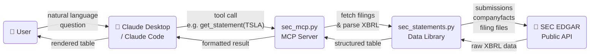

# SEC Financials MCP

A Model Context Protocol (MCP) server that pulls as-reported financial data directly from SEC EDGAR for any US public company. Built for Claude Desktop.

---

## How It Works



---

## What It Does

Connects Claude to SEC XBRL filings in real time. You can ask naturally — "Show me Tesla's quarterly income statement" or "What notes does IBM file?" — and get structured financial data back without leaving the conversation.

Data comes directly from EDGAR. No third-party data provider, no stale snapshots.

---

## Capabilities

### Core Statements
Pull the income statement, balance sheet, or cash flow statement for any SEC-reporting company — annual or quarterly.

### Notes & Disclosures
Every filing contains dozens of notes beyond the three core statements: segment breakdowns, geographic revenue, debt schedules, lease obligations, revenue disaggregation, and more. Use `discover` to see everything available for a specific company, then fetch any note by name.

### Long-Term History
Pull 10+ years of annual data or 20+ quarters of history for any core statement line item — not just the three years shown in the latest filing.

### Segment Data
Segment and geographic breakdowns are retrieved from XBRL dimensional data, including multi-axis tagging (e.g. IBM's Software / Consulting / Infrastructure split).

### Company Comparisons
Fetch the same statement for multiple companies and compare side by side in one table.

---

## Tools

| Tool | What It Does |
|---|---|
| `discover(ticker)` | Lists every available statement and note for a company, with role URIs needed to fetch notes |
| `get_statement(ticker, section, period)` | Fetches a core statement or any note disclosure — annual or quarterly |
| `get_history(ticker, section, period)` | Fetches long-term history using all available SEC data |

---

## Example Prompts

**Quick pulls**
- "Show me TSLA's latest quarterly income statement"
- "Pull META's annual balance sheet"

**Discovery**
- "What notes are available for NFLX?"
- "What disclosures does IBM file?"

**History**
- "Give me 10 years of annual revenue for AAPL"
- "Show MSFT's quarterly cash flow history"

**Comparisons**
- "Compare income statements for META, GOOGL, and NFLX"
- "Show total assets for TSLA and GM side by side"

**Notes**
- "Pull the revenue breakdown note for AMZN"
- "Show me the debt schedule for TSLA"

---

## Data

- **Source**: SEC EDGAR XBRL filings (10-K, 10-Q, 20-F)
- **Coverage**: All US public companies that file with the SEC
- **Timeliness**: Latest available filing — typically within days of SEC acceptance
- **History**: Via the SEC companyfacts API, which aggregates all historical filings
- **Units**: Values scaled to millions ($M) where applicable; EPS and per-share values shown at original scale
- **Tags**: Each row shows its XBRL concept tag (e.g. `[us-gaap:Revenues]`) and dimension member for segment rows (e.g. `[ibm:SoftwareMember]`)

---

## Setup

1. Download the zip and unzip it anywhere (e.g. your Downloads folder)
2. Open Terminal — press **Cmd + Space**, type **Terminal**, press Enter
3. Drag the unzipped folder into the Terminal window, then type `/install.sh` and press Enter:
```
/Users/you/Downloads/sec-financials/install.sh
```
4. Follow the prompts — it will ask for your name and email (required by the SEC to identify API clients)
5. Restart Claude Desktop or Claude Code when done

---

## How It Works

### Architecture: two files

**`sec_mcp.py`** is the MCP server — the layer that Claude Desktop talks to. It registers three tools (`discover`, `get_statement`, `get_history`) and handles communication with Claude using the FastMCP framework. When you ask Claude a financial question, Claude decides which tool to call, passes arguments (ticker, section, period), the server runs the tool, and the result goes back into Claude's context as text.

**`sec_statements.py`** is the data library that does all the actual work — fetching, parsing, and building the output tables. It has no knowledge of Claude or MCP; it's a standalone pipeline you can also run from the command line. `sec_mcp.py` imports it and calls its functions.

---

### XBRL: what the filing actually contains

Every SEC filing submitted in XBRL format is a folder of files, each serving a specific role in the data model:

| File | Role | What it contains |
|---|---|---|
| `FilingSummary.xml` | Index | A menu of every statement and note in the filing, with a role URI identifying each section |
| `*_pre.xml` | Presentation linkbase | The ordered, indented tree of line items for each statement — what appears, in what order, at what indent depth |
| `*_lab.xml` | Label linkbase | Human-readable names for every XBRL concept tag (e.g. `us-gaap:Revenues` → "Revenues") |
| `*_cal.xml` | Calculation linkbase | The arithmetic relationships between line items (e.g. Gross Profit = Revenue − Cost of Goods Sold) |
| `*_htm.xml` | Instance document | The actual numbers, extracted from the iXBRL HTML filing — every tagged value with its reporting period and dimensional context |

The instance document is the most important file. It's a flat list of facts — each one a (concept, context, value) triple. The context specifies the time period (e.g. "nine months ended September 30, 2025") and optionally a dimensional breakdown (e.g. "Software segment"). The presentation linkbase is what turns this flat list into a structured statement with section headers, subtotals, and correct ordering.

---

### Step by step: what happens when you ask for a statement

**1. Resolve the ticker to a CIK**

The SEC identifies every filer by a CIK (Central Index Key), not a ticker. The script fetches SEC's master ticker file and looks up the company's CIK. Apple is `0000320193`, Tesla is `0001318605`, etc.

**2. Find the latest filing**

It queries the SEC submissions API (`data.sec.gov/submissions/CIK##########.json`), which returns a list of all filings for that company, sorted newest first. For annual data it looks for a 10-K (or 20-F for foreign private issuers); for quarterly it looks for a 10-Q. The `nth` parameter (default 0 = most recent) lets the quarterly stitcher reach back into older filings.

**3. Locate and fetch the XBRL files**

Each filing has a folder in EDGAR. The script fetches the filing's index (`index.json`) to find the specific files — presentation linkbase, label linkbase, calculation linkbase, and instance document — then downloads each one.

**4. Parse the instance document**

The iXBRL instance is extracted from the filing's HTML file. The parser walks every `<ix:nonFraction>` and `<ix:nonNumeric>` element and extracts:
- The concept tag (e.g. `us-gaap:NetIncomeLoss`)
- The context ID, which maps to a `<xbrli:context>` element containing the period dates and any dimensional axes
- The numeric value and its unit (USD, shares, etc.)

All facts are stored in a dict keyed by concept name. Each context is parsed into a `Context` object with `start`, `end`, and `dims` (list of axis/member pairs for segment facts).

**5. Walk the presentation tree**

The presentation linkbase (`_pre.xml`) is an XML file containing one `<presentationLink>` per statement role. Each link is a tree of `<loc>` elements connected by `<presentationArc>` relationships with `order` and `preferredLabel` attributes. The script walks this tree depth-first, recording each line item's concept name, indent depth, preferred label role, and whether it's an abstract header, a total, or a regular data row.

Structural nodes (Axis, Domain, Member) in the presentation tree are collected separately — they describe the dimensional schema, not the rows of the statement. These are used in the next step.

**6. Resolve dimensional (segment) facts**

This is the most complex part. Standard facts are simple: one concept, one period, one value. Segment facts add one or more dimensions — for example, Tesla tags automotive revenue with `tsla:AutomotiveRevenuesMember` on a `tsla:RevenueAndCostAxis`.

For each line item in the presentation, the script checks whether any dimensional members have data for that concept, and if so emits a member row for each one (e.g. "Automotive Sales: $20,006M") before the plain aggregate row. This is how you see Tesla's revenue breakdown by segment rather than just a single revenue number.

IBM is a harder case: each segment fact carries *two* dimensions simultaneously — one axis identifies it as a segment figure (vs. a corporate/elimination figure) and a second axis names the segment (Software, Consulting, Infrastructure). The script handles this by checking whether the target axis/member pair is *contained in* the full set of dimensions on a context, rather than requiring an exact match. When two facts for the same period have different numbers of dimensions, it prefers the one with fewer dimensions (more specific to that segment, less likely to be an aggregate).

**7. Format the output**

The DataFrame is serialized to a compact plain-text format designed to minimize token usage in Claude's context window. Compared to a markdown table, this format uses roughly 40% fewer tokens because it skips pipe characters, header separators, and padding.

The format:
- Groups values on a single line separated by ` | `
- Prefixes segment rows with `  - ` and wraps member names in the line
- Uses `ALL CAPS` for total rows
- Annotates each row with its XBRL concept tag in brackets (e.g. `[us-gaap:NetIncomeLoss]`)
- Scales values to millions automatically when numbers are large enough
- Keeps EPS and per-share values at their original scale (so `$1.07` doesn't become `0` after dividing by 1,000,000)
- Deduplicates: if a plain aggregate row has identical values to member rows already shown, it's dropped

---

### How quarterly trend stitching works

A single 10-Q filing only contains two columns: the current quarter and the same quarter one year ago (e.g. Q2 2026 and Q2 2025). This is what GAAP requires for comparative disclosure, but it means a single filing gives you only two data points — and they look like annual data if you put them side by side.

To build a true trailing-quarter view (e.g. Q2 2026, Q1 2026, Q4 2025, Q3 2025, Q2 2025, Q1 2025), the `get_statement` tool fetches several 10-Q filings in sequence — most recent first — and extracts only the current-quarter column from each one. These columns are then stitched together using the XBRL concept tag and dimension member as the join key.

The stitcher stops once it has collected the requested number of quarterly columns (default: 6). It handles gaps gracefully — if a concept appears in one quarter's filing but not another, that cell shows a dash rather than crashing.

---

### How long-term history works

`get_statement` reads one filing at a time, covering 2-3 years at most. `get_history` uses a different SEC endpoint: the companyfacts API (`data.sec.gov/api/xbrl/companyfacts/CIK##########.json`). This API aggregates every reported value for a company across *all* of its historical filings into a single JSON response — every 10-K and 10-Q going back to the company's first XBRL filing.

The script fetches this JSON, filters to the right form type (annual or quarterly) and period duration (about 365 days for annual, about 90 days for quarterly), and then joins those values onto the row structure from the latest filing — using the XBRL concept tag as the key.

The tradeoff: this API only covers standard US-GAAP and IFRS tags. Company-specific extension tags (like `tsla:AutomotiveRevenuesMember`) are not available, so segment breakdowns and custom line items appear blank in history mode. For those, use `get_statement` against a specific filing.

---

### How notes work

Beyond the three core financial statements, every SEC filing contains dozens of notes — narrative disclosures accompanied by structured data tables. These are separate presentation roles in the filing, each with a unique role URI (a URL-like string that identifies the section within that filing).

The `discover` tool fetches the `FilingSummary.xml` index for a company's latest filing and lists every available section, grouped by category (Statements, Notes, Policies, etc.), along with its role URI. You can then pass that URI directly to `get_statement` to fetch any note using the same parsing pipeline as a core statement — same presentation tree walk, same dimensional resolution, same compact output format.

---

### How MCP connects this to Claude

Claude Desktop loads the MCP server at startup by running `python3 sec_mcp.py`. The server registers its tools with FastMCP and waits for calls over stdin/stdout. When Claude decides to call a tool (e.g. `get_statement("TSLA", "income_statement", "quarterly")`), the MCP framework deserializes the call, executes the Python function, and returns the result as a string that appears in Claude's context.

The server prepends a display directive to every result instructing Claude not to reformat the data — column headers should stay in `YYYY-MM` format, no derived columns (YoY, margins), no secondary tables. This prevents Claude from "helpfully" reinterpreting the data in ways that could introduce errors or add information that wasn't in the filing.

Claude itself never touches the raw XBRL data. Everything is resolved to a human-readable table before it reaches Claude's context window.

---

## Limitations

- **Standard GAAP concepts only for history**: `get_history` uses the SEC companyfacts API, which covers standard US-GAAP and IFRS tags but not company-specific extension tags. Segment breakdowns and custom line items are only available via `get_statement` against the specific filing.
- **Latest filing per period**: `get_statement` returns data from the most recent filing of the requested type. To access older filings, use `get_history`.
- **US filers only**: Covers companies that file with the SEC. Foreign private issuers on 20-F are supported; companies listed only on foreign exchanges are not.
- **Quarterly trend gaps**: Q4 data for companies with December fiscal year ends is typically reported in the annual 10-K, not a standalone 10-Q, so it may not appear in the trailing-quarter trend view.
